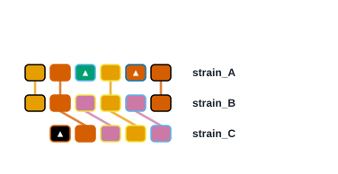
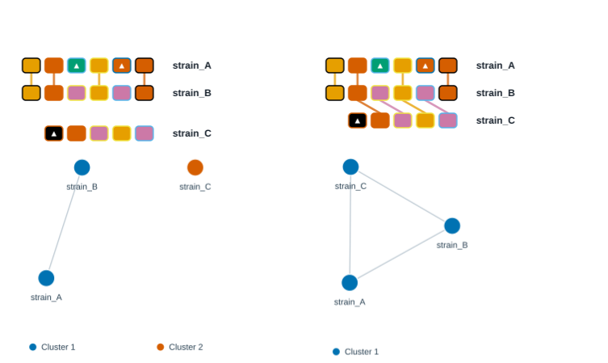
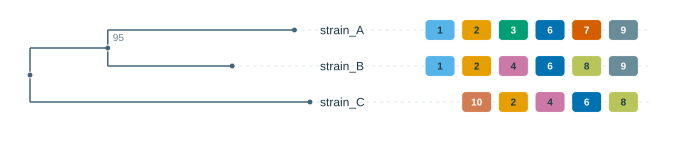
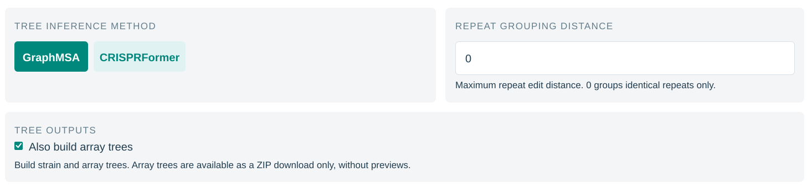
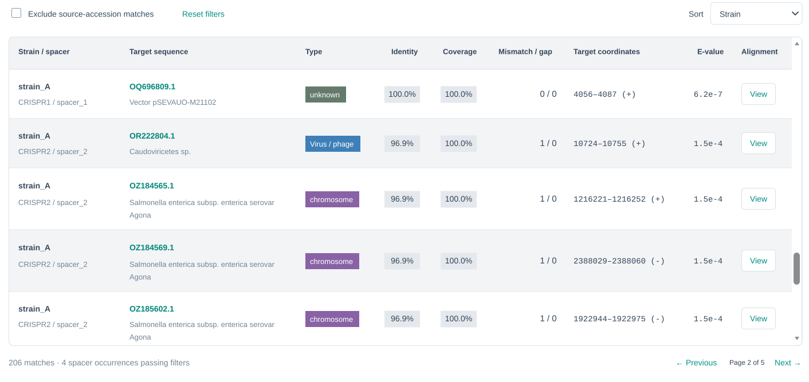
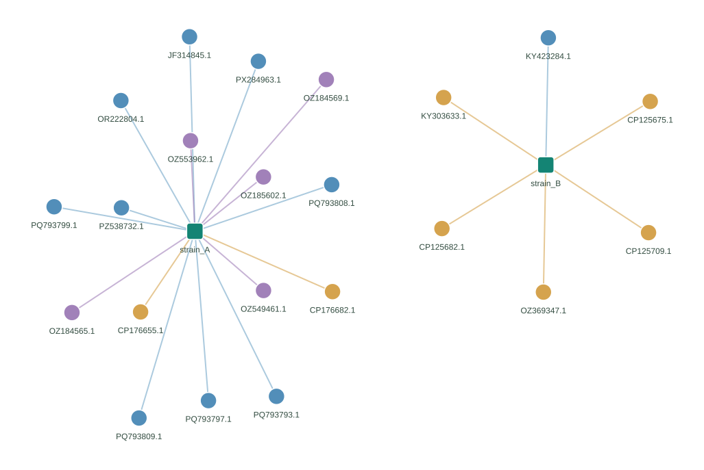

# Quick start

This walkthrough uses small illustrative data so you can learn what the plots mean before processing a real dataset. The example Newick is supplied for practice; it is not a tree inferred from the numbered arrays.

## 1. Plot three arrays

Download [example-arrays.txt](examples/example-arrays.txt), or paste:

```text
strain_A	1,2,3,6,7,9
strain_B	1,2,4,6,8,9
strain_C	10,2,4,6,8
```

1. Open **SpacerMap** from Analysis.
2. Paste the text or upload the file, using only one input method.
3. Keep **Right** alignment and **No clustering**.
4. Select **Commit**.



You should see **three rows**, **9 distinct spacer labels** and **6 shared labels**. There are 17 spacer occurrences in total. IDs 3 and 7 occur only in strain A; ID 10 occurs only in strain C. Those array-specific types are triangles. Shared types connect across neighboring rows where applicable.



Try **Ancestral spacer** and commit again: A and B share the rightmost ID 9, while C ends in 8 and forms its own group. Then try **Shared spacer**: all three arrays connect because every pair shares at least two distinct IDs. **Show cluster network** displays those links. This illustrates that different grouping rules answer different questions.

Choose SVG and **Download SVG**. **Download numbered file** is unnecessary for already numbered input; retain the example TXT.

## 2. Combine the arrays with a tree

Download [example-tree.nwk](examples/example-tree.nwk), or copy:

```text
((strain_A:0.12,strain_B:0.08)95:0.05,strain_C:0.18);
```

1. Open **ArrayPhyloViz**.
2. Add the tree under **Phylogenetic tree**.
3. Add the same arrays under **CRISPR arrays**, using the TXT or your exported SpacerMap SVG.
4. Select **Exact names**, then **Commit**.
5. Open **Review and edit mapping**: all three arrays should map to three leaves, with none unassigned.
6. Adjust row spacing and label space. Turn on **Use branch lengths** to compare proportional lengths with the default topology layout.
7. Keep the private link created by **Commit**. After edits, use **Save private link** again or **Save project** for a local JSON, then export SVG, PNG or PDF.



The tree groups A and B together. The array track helps inspect which types they share with each other and C. The internal label `95` came from the example tree; the editor did not calculate support. Reopen the saved JSON with **Open saved project** to continue editing.

## 3. Try data preparation and inference

For a detector-free trial, open **CRISPRPrep → Import JSON results → Load example JSON**, keep the defaults and select **Run**. Examine retained/filtered arrays and the processed-row preview, then download **Processed CSV** and the report. To compare a different filter, load the example JSON again, change that filter and select **Run** for a new job. Keep a record of the settings for each result.



To try tree inference, open **CRISPRPhylo → Load example**, keep **GraphMSA**, then select **Commit**. This requires the site's inference service and can take time. Inspect the Newick source and download `.nwk`. Leave **Repeat grouping distance** at 0 for this first trial. Enable **Also build array trees** before submission if you also want the group-level ZIP. The built-in examples in different tools are independent; they are not automatically a matched dataset.

## 4. Try sequence retrieval or target searching

**SeqFetcher → Load example → Commit** retrieves example nucleotide records from NCBI. Check metadata, keep the private results link, and download FASTA/ZIP for your records. For a whole-genome assembly, enter its GCA_/GCF_ accession with **Nucleotide** selected; one retrieved row may contain multiple FASTA contigs. These examples demonstrate retrieval, not bacterial CRISPR detection.





For **SpacerTarget**, use **Load example** or [example-spacers.fasta](examples/example-spacers.fasta), review the settings, then select **Search**. This submits a real NCBI search. Save **Copy results link**. Results depend on the database and search time, so no fixed hit count is expected. Follow the [SpacerTarget guide](tools/spacer-target.md) to interpret Strict/Exact filters and network edges.


After a job is accepted, test recovery by copying its link into **My Jobs → Retrieve a job**. Open the result and confirm it is the expected dataset. Downloads and original inputs are still needed for long-term storage because server results expire after seven days.

Continue with the [real-data workflow](workflow.md) once input names and result types are familiar.
