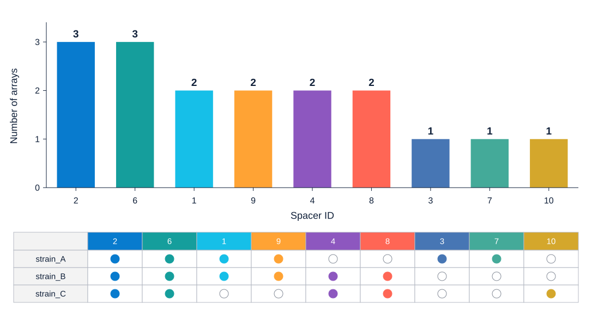

# SpacerMap

Use **SpacerMap** (`/spacer-map`) to compare spacer order and sharing across CRISPR arrays. It produces an array diagram, per-spacer array counts, a presence/absence chart and, when clustering is enabled, an array network. Genome FASTA must first go through [CRISPRPrep](crispr-processing.md).

## Prepare your input

Choose **one** input source per run. Leave the paste box empty when uploading.

| Input | How to prepare it |
| --- | --- |
| Numbered arrays | Paste one named array per line, or upload TXT/TSV. Each number identifies a spacer type. |
| Spacer sequences in a table | Paste or upload **Processed CSV** from CRISPRPrep, retaining its header; each row is one spacer. CRISPRPrep can also transfer it directly. |
| CRISPRCasFinder JSON | Upload one JSON. Direct import keeps evidence levels 3–4 and applies fixed direction/N filters. Use CRISPRPrep first to control filtering. |
| Spacer FASTA | Upload one FASTA containing one array, with one record per spacer. The filename becomes the array name. This is not whole-genome input. |
| Direction folders | Select a folder with spacer FASTA files under `pos`/`forward` or `neg`/`reverse`. Each file is one array. |
| Arrays written as DNA sequences | Upload TXT/TSV with one named array per line. Use upload for sequence-to-number conversion; pasted array-format text is treated as labels, while a recognized CSV header triggers CSV conversion. |

Paste this three-array example. The page's **Load example** supplies a separate, alignment-dependent example:

```text
strain_A_CRISPR1	1,2,3,6,7,9
strain_B_CRISPR1	1,2,4,6,8,9
strain_C_CRISPR1	10,2,4,6,8
```

Use a tab between each name and list. Keep array names unique. For CSV, SpacerMap combines nonempty `Folder` and `Seq_Name` as `Folder_Seq_Name`; without Folder it uses Seq_Name alone. For example, Folder `702` and Seq_Name `NZ_JOLF01000035_1` produce `702_NZ_JOLF01000035_1`. Different samples can reuse an array name if their combined labels differ. Avoid collisions caused by underscores in custom field values, and use one consistent orientation per combined label.

## Choose alignment and clustering

| Alignment | What changes | When it helps |
| --- | --- | --- |
| **Right** (default) | Last spacers line up at the right edge. | Compare ends of consistently oriented arrays. |
| **Left** | First spacers line up at the left edge. | Compare starting blocks. |
| **Justify** | Shared spacers guide horizontal spacing while preserving order. | Follow shared internal blocks across arrays of different lengths. |

Alignment is a drawing choice. Left/right does not determine the biological leader or trailer end. Establish orientation from your source data before assigning acquisition direction. Justified gaps are visual spacing, not measured genomic gaps or proof of deletion.

| Clustering | Exact grouping rule | Interpretation |
| --- | --- | --- |
| **No clustering** | Keeps input row order. | Useful when samples already have a meaningful order. |
| **Shared spacer** (default) | Links pairs sharing at least two distinct IDs; connected arrays form a group. | Two arrays can join through a third without sharing two IDs directly. |
| **Ancestral spacer** | Groups arrays with the same **rightmost spacer ID**. | A terminal-spacer grouping heuristic; it does not reconstruct an ancestor or establish which spacer is oldest. |

Clustering reorders rows, never spacer order within an already normalized array. After a completed run, changing alignment or clustering automatically updates the current preview using its normalized arrays. These preview-only changes do not overwrite the saved job. To preserve them, download the current SVG or select **Commit** and save the new job link. On a fresh page the defaults are **Right / Shared spacer**; select **No clustering** explicitly when input row order matters.

## Run and read the diagram

1. Paste the example or upload your input.
2. Select alignment and clustering; **Right** and **No clustering** are a useful first view.
3. Select **Commit** and wait for the preview.
4. Check array names, spacer IDs and the displayed alignment/clustering. Use **Spacer occurrence** below for per-ID counts.
5. With clustering enabled, select **Show cluster network** to inspect pairwise connections.

Each row is an array; each symbol is one spacer occurrence. IDs identify types within this dataset. Shared types use consistent colors. Types found in only one array are drawn as triangles, including every repeated copy within that array. A triangle means *array-specific*, not necessarily a spacer seen only once. Use IDs as the primary reference when colors look similar.

Links between neighboring rows connect matching spacer IDs. A break in links does not by itself identify a biological gain or loss. Check IDs, order and orientation together.

**Distinct spacer labels** are different IDs, not the total number of symbols. **Shared labels** occur in at least two arrays. Use the occurrence table below to inspect how many arrays contain each ID. The example above has 3 arrays, 9 distinct labels and 6 shared labels, with 17 total occurrences. IDs 3, 7 and 10 are array-specific.

In the cluster network, nodes are arrays. A line indicates that the pair meets the selected grouping rule. Network proximity is a layout aid, not evolutionary distance. The network is unavailable with **No clustering**. Select a node to see its array, cluster and connection count; select an edge to see the pair and shared-ID count. Drag nodes to rearrange them or drag the background to pan. Use **Ctrl + scroll** (**Command + scroll** on Mac), zoom buttons or **Fit network** to navigate. Choose **Force-directed**, **Circle** or **Grid**, and use **Reset layout** to recalculate the layout. Its **Download SVG** and **Download PNG** buttons export the network separately from the array map.

## Navigate and recover the preview

Drag to pan and use **Ctrl + scroll** (**Command + scroll** on Mac) to zoom. Scrolling without a modifier scrolls the page. The **+ / −** and **Fit** controls adjust the preview; with the preview focused, `0` fits the diagram and arrow keys pan. These changes do not crop or resize exported figures.

Rendering creates a saved job. Copy its private results link to restore SVG, normalized array text, any sequence-to-ID mapping, occurrence statistics, alignment, clustering and seed through [My Jobs](../my-jobs.md) for seven days after the task ends. Keep your original data, array-map SVG and sequence mapping for reruns. Changing the seed triggers another render; save the link for the version you intend to retain. Recovery fills the input box with normalized array text, not the original sequence upload. Copy that text if you need reusable array-per-line TXT. Recommitting it preserves IDs and order but cannot regenerate a sequence mapping; keep the original mapping download or reselect original sequence input when needed.

## Count how widely each spacer occurs

Use **Spacer occurrence** to compare the number of arrays containing each spacer ID. This panel uses the normalized arrays from the **last completed run**, including sequence-to-ID conversion when applicable. It is available with **No clustering** as well as either clustering mode.

1. Submit your input with **Commit** and wait for the array diagram.
2. Select **Spacer statistics** in the page navigation, or scroll to **Spacer occurrence**.
3. Expand **View spacer counts (first 100; CSV includes all)** to read the counts without drawing a chart.
4. Select **Show occurrence chart** to display the bar chart and presence/absence matrix. Select **Hide occurrence chart** to collapse it again. Scroll inside the preview when the figure is wider or taller than the visible area.
5. Use the **Format**, **DPI** and download controls at the bottom of this panel for statistics exports. These controls are separate from the array-map export controls.

### What the counts mean

**Number of arrays** counts each array once for each spacer ID, even if that ID occurs several times in that array. It is neither total spacer copies nor the number of strains. If one strain contributes several arrays, each array is counted separately. Counts reflect the arrays retained in this run, not every array originally detected before filtering.

For the three-array example above, the expected counts are:

| Spacer IDs | Number of arrays | Interpretation |
| --- | --- | --- |
| `2`, `6` | 3 | Present in every input array. |
| `1`, `9`, `4`, `8` | 2 | Shared by two input arrays. |
| `3`, `7`, `10` | 1 | Restricted to one input array. |

The chart sorts IDs by decreasing count. Ties follow first appearance in the normalized input, so it is not a numeric-ID sort. For this example the columns are `2, 6, 1, 9, 4, 8, 3, 7, 10`. Matrix rows retain input array order; clustering can reorder the main array diagram without changing these statistics.



This figure uses the short array names in the [quick-start input](../examples/example-arrays.txt). The counts are identical to the example above. Download its [statistics CSV](../examples/SpacerMap-occurrence.csv) to compare with your export.

In the upper panel, bar height and the number above each bar give **Number of arrays**. In the lower matrix, each column is that same spacer ID and each row is an array: a **filled circle** means present; a **hollow circle** means absent from that array's retained input. The matrix does not show copy number, spacer order or genomic position. Absence from the input is not, by itself, evidence of a biological loss.

For example, `array_A: 1,1,2` and `array_B: 2,3` contain five spacer copies, but the array counts for IDs 1, 2 and 3 are 1, 2 and 1. Repeated ID 1 does not increase its bar to 2. These statistics use SpacerMap IDs, so similarity-grouped sequences can contribute to the same count; they do not establish exact nucleotide identity.

Colors connect each bar with its matrix column. They use a separate deterministic palette of 50 distinct colors, which can still look similar; read the ID labels rather than matching colors between panels. Changing the map's **Seed** does not change occurrence counts or this chart's palette. Changing alignment or clustering also leaves counts unchanged for the same normalized input.

### Export the statistics

| Control / format | Output and scope |
| --- | --- |
| **Download statistics CSV** | `SpacerMap-occurrence.csv`, with columns `Spacer ID` and `Number of arrays`. Includes every distinct spacer ID, even when the on-page table shows only the first 100 or charting is unavailable. |
| **SVG**, **PDF**, **EPS** | The complete bar chart and presence/absence matrix in one vector figure. DPI is disabled for these formats. |
| **PNG**, **JPG**, **TIFF**, **WEBP** | The same complete figure as a raster image. Set a whole-number DPI from 36 to 2,400; the default is 300. |

Choose a format and select **Download SVG**, **Download PDF**, or the corresponding download button. Image files are named `SpacerMap-occurrence.<format>`. You can download a figure without first opening its preview. CSV contains counts, not the matrix or original sequences, so keep the numbered input with it.

Charts require **1–50 distinct spacer IDs** and include all of them. If there are more than 50, both chart preview and chart export are disabled; the tool does **not** silently show a top-50 subset. The statistics CSV still includes every ID. To make a smaller chart, select a meaningful subset, submit it as a new run and clearly identify that subset when reporting its counts. Reuse numbered input if you need consistent IDs across subsets.

Raster statistics exports are limited to **40 million pixels**. If export exceeds this limit, lower DPI or use SVG/PDF. SVG/PDF/EPS still require no more than 50 distinct IDs. An occurrence SVG is a statistics figure and cannot replace the metadata-bearing **array-map SVG** used in ArrayPhyloViz.

Statistics can be recovered with saved results when the normalized array data is available. If an older result reports that statistics are unavailable, resubmit the original or saved numbered input. Editing the input box alone does not update a completed run's counts; select **Commit** again.

## Understand automatic spacer numbering

For sequence inputs, sequences with pairwise global-alignment identity of at least **0.84** are connected, and each connected group receives an ID. Similar sequences can share an ID without being identical; transitive groups can include members below 0.84 identity to one another. Numbering depends on the dataset and ordering. ID `1` in two independent runs is not a universal spacer identity.

CSV/JSON and direction-folder inputs use orientation information during conversion. CSV rows keep their supplied order for both strands: CRISPRPrep has already reversed negative-array row order, and SpacerMap does not reverse it again. Negative CSV rows use `Reverse_Complement_Sequence`, or compute it when missing. CSV rows with `ND` are skipped. Direction-folder conversion applies its own negative-array ordering rule, so inspect the result when changing input routes. Already numbered input is drawn in supplied order. Numeric FASTA headers are used directly as IDs.

Reuse the same normalized array text or metadata-bearing array-map SVG when comparing figures. **Download numbered file** is an ID–sequence lookup, not array input. For sequence-level searches, retain original sequences and use [SpacerTarget](spacer-target.md); numeric IDs cannot be searched.

## Export and continue

For the **array diagram**, in **Customize export**, set **Seed**, **Format** and, for raster output, **DPI**. Seed defaults to 2 and changes colors, not IDs or clustering. Wait for the preview update before downloading. Preserve the same dataset, order and seed to reproduce the palette.

| Output | Use it for |
| --- | --- |
| SVG | Scalable figures and importing array metadata into ArrayPhyloViz. |
| PNG | Slides or image previews. |
| JPG/JPEG, TIF/TIFF, WEBP | Workflows requiring these formats. Raster DPI defaults to 300; allowed range is 36–2,400. |
| **Download numbered file** | Tab-separated `.txt` with `Spacer_ID` and `Spacer_Sequence`, one row per distinct ID–sequence pair. Similarity-grouped variants can share an ID. Negative CSV spacers use the reverse complement used for numbering. No array names, membership or order are included. Number-only input has no sequence mapping. |

To combine arrays with a tree, open [ArrayPhyloViz](figure-composer.md), upload a newly exported **array-map SVG** and add a Newick tree. SVG carries array membership, ordered IDs, colors and source positions. An existing one-array-per-line TXT also works, but the ID–sequence mapping from **Download numbered file** does not. To save normalized array TXT, retrieve the job and copy the restored input text; the saved result report also includes `export_text`.

## Troubleshooting

| Symptom | Check |
| --- | --- |
| No usable JSON arrays | Direct import excludes low evidence, unresolved `ND` and organisms with N-containing spacers. Use CRISPRPrep to see exclusion reasons. |
| Two samples appear as one row | Inspect combined `Folder_Seq_Name` labels; without Folder, Seq_Name alone must be unique. |
| Unexpected shared IDs | Numbering groups similar sequences; inspect original sequences for exact identity. |
| No cluster network | Select a clustering mode and wait for the preview update. Isolated nodes are valid when no pair meets the rule. |
| Occurrence chart is disabled | Check the distinct-ID count: charts require 1–50 IDs. Download the statistics CSV for larger datasets. |
| A count is lower than the number of copies | Each array contributes at most one count per ID, even with repeated spacers. |
| Statistics panel could not load | Reload the page and retrieve the saved job. The array input and map can still work independently. |
| ID–sequence download fails as array input | Use the array-map SVG in ArrayPhyloViz or restore/copy normalized array text; the mapping file has no array membership. |
| IDs/colors differ between analyses | Reuse the same normalized array input and seed; IDs are not global across datasets. |
