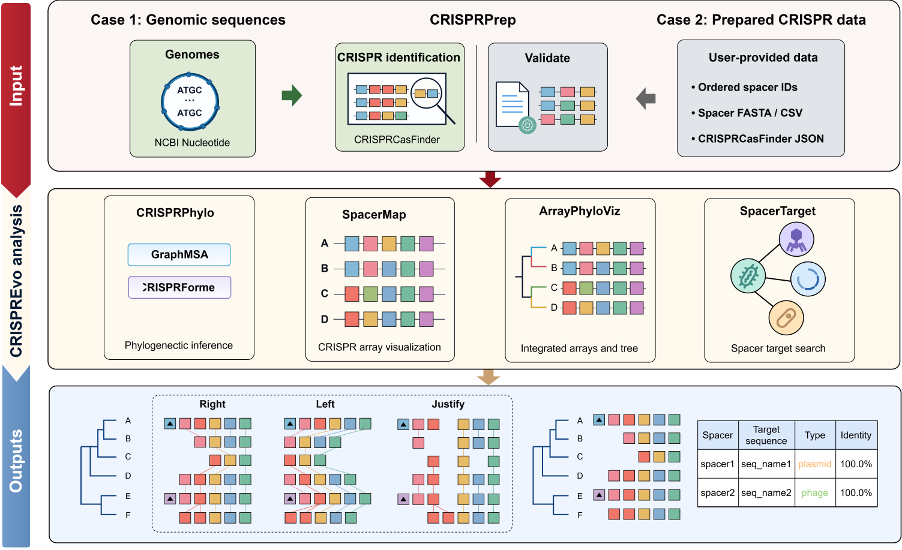

# End-to-end workflow

Start at the first step for which you have suitable data. Spacer visualization, tree inference and target searching are separate downstream uses of prepared spacers; target searching is optional and does not need a tree.

[View the workflow at full size](assets/images/CRISPREvo_workflow.svg).

## 1. Retrieve or collect genome sequences

Use [SeqFetcher](tools/ncbi-sequence-fetcher.md) for nucleotide or GCA_/GCF_ assembly accessions/UIDs, or start with your own genome FASTA. Verify accession, organism and sequence length. Save metadata and maintain a sample list linking each strain to its input records.

Keep contigs from one strain together. Do not combine unrelated strains in one detection input and expect FASTA headers to create separate strain identities. Protein records are not genome-detection inputs.

## 2. Detect each sample and prepare a combined spacer table

In [CRISPRPrep](tools/crispr-processing.md), detect one sample per run from FASTA, or select **NCBI accession** to retrieve nucleotide/assembly records and detect automatically. Keep contigs of one assembly together. A list spanning several strains is combined into one detection input and does not automatically become several strain IDs. Download **CRISPRCasFinder JSON** from each detection run and save it under a meaningful sample name. Alternatively, use existing CRISPRCasFinder outputs arranged as `sample_A/result.json`, `sample_B/result.json`, and so on.

Import the JSON results together, set evidence/count/direction/N filters, and select **Run**. Review **Filtered out** arrays and the report before changing thresholds. Keep original JSON and download **Unprocessed CSV**, **Processed CSV** and the report. Record filtering settings separately; uploaded JSON and processing options are not retained in the saved result.

Check these identities in the processed table:

| Field             | Downstream role                                                                                                   |
| ----------------- | ----------------------------------------------------------------------------------------------------------------- |
| `Folder`        | Strain grouping in CRISPRPhylo and SpacerTarget. All arrays belonging to one strain should share it.              |
| `Seq_Name`      | Array grouping in SpacerMap and array identity in SpacerTarget. Use a unique name for each distinct array.        |
| `Organism_Name` | Description-derived organism label and grouping for CRISPRPrep's organism-wide N filter; it is not the strain ID. |

## 3. Infer strain relationships with CRISPRPhylo

Transfer the processed CSV using CRISPRPrep’s **CRISPRPhylo** link, or paste/upload it to [CRISPRPhylo](tools/crisprphylo.md). Confirm at least two usable strain IDs, select GraphMSA or CRISPRFormer and a model profile where applicable, and set **Repeat grouping distance** (start at 0). Read the method-specific meaning of this control in the guide. Enable **Also build array trees** if needed, then select **Commit**.

Check leaf names and Newick. Download the strain tree, optional array-tree ZIP and result report, and record method/profile and repeat distance. Use midpoint or branch rooting only with a justified interpretation. Download any changed Newick before leaving: the saved job keeps its original root. Tree relationships depend on the retained CRISPR evidence and method; vertical leaf order and completion status are not measures of evolutionary confidence.

## 4. Compare array structure with SpacerMap

Upload the same processed CSV to [SpacerMap](tools/spacermap.md), start with **Right / No clustering**, and select **Commit**. Review names, order, array-specific triangles and shared IDs. Only interpret leader/trailer ends after confirming orientation from the source data.

Try **Shared spacer** to inspect groups connected by two or more IDs, or **Ancestral spacer** to group identical rightmost IDs. Export SVG and **Download numbered file**. Keep the numbered file to preserve the IDs used in the figure; re-numbering a different subset may assign different labels.

## 5. Search candidate targets when relevant

Upload the processed CSV to [SpacerTarget](tools/spacer-target.md), or select the **SpacerTarget** link below CRISPRPrep’s downloads. Verify that original spacer sequences are 15–100 A/C/G/T bases and that sample IDs are present. Choose the hit limit and select **Search**.

Save the results link. On completion, inspect Strict matches, open alignments, then compare Exact or Explore if needed. A sequence match does not establish a functional CRISPR target or infection relationship. Download all candidates, the search report and a filtered TSV documenting the evidence used in your study.

Do not substitute SpacerMap numbered TXT: a spacer number has no searchable nucleotide sequence.

## 6. Compose an integrated figure

Open [ArrayPhyloViz](tools/figure-composer.md), upload Newick and the SpacerMap SVG or numbered TXT, and select **Commit**.

Match arrays to the original leaf names. `Seq_Name` may differ from `Folder`; use the processed table to assign arrays manually when suffix matching is insufficient. Review all missing leaves and unassigned arrays. Multiple arrays can belong to one strain.

Adjust label space, row spacing, branch display and annotations. Save project JSON and mapping TSV, then export SVG, PNG or PDF. Use **Save private link** to preserve the current edited snapshot for recovery through My Jobs. A saved project preserves figure edits; the processed CSV and original JSON preserve their sequence basis.

## Keep an analysis bundle

Keep sample metadata, original FASTA/JSON, processing report, processed CSV, numbered arrays, Newick, optional target-search report/TSVs, final mapping, editable project and exported figures. Record the analysis date, software version if available, filtering choices, tree method/profile, SpacerMap grouping/alignment/seed and figure edits.

Save private results links as you proceed; [My Jobs](my-jobs.md) can restore accepted jobs across devices. Results expire seven days after completion and inputs are deleted at task end, so links do not replace downloaded evidence or a settings record.

See [Downloads](reference/downloads.md) for a file-by-file guide and [Troubleshooting](troubleshooting.md) for recovery steps.
