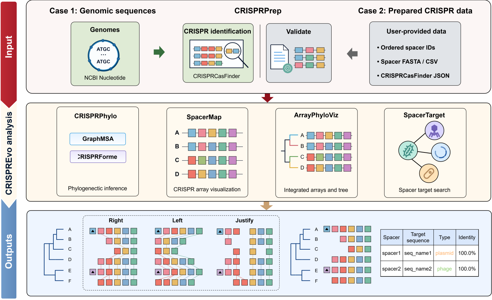

# End-to-end workflow

Start at the first step for which you have suitable data. Spacer visualization, tree inference and target searching are separate downstream uses of prepared spacers; target searching is optional and does not need a tree.

[View the workflow at full size](assets/images/CRISPREvo_workflow.svg).

## 1. Retrieve or collect genome sequences

Use [SeqFetcher](tools/ncbi-sequence-fetcher.md) for nucleotide or GCA_/GCF_ assembly accessions/UIDs, or start with your own genome FASTA. Verify accession, organism and sequence length. Save metadata and maintain a sample list linking each strain to its input records.

Keep contigs from one strain together in a single FASTA file. Separate FASTA files can be submitted together while retaining their sample identities. Protein records are not genome-detection inputs.

## 2. Detect samples and prepare a combined spacer table

In [CRISPRPrep](tools/crispr-processing.md), choose one route:

- **Upload FASTA**: up to 100 files / 100 MB, one sample per file. `sample_A.fna` produces `Folder=sample_A`.
- **Paste sequence**: use `>Sample Seq_Name Organism_Name` on every record; records sharing Sample belong to the same strain.
- **NCBI accession**: up to 100 IDs; retrieved contigs are grouped by the requested accession. Use one assembly accession per strain when available.
- **Import JSON results**: one sample per JSON basename. Rename `sample_A/result.json` to `sample_A.json` before import if you need `Folder=sample_A`.

Set evidence/count/direction/N filters and select **Run**. Review **Filtered out** arrays and the report, then download **Processed CSV**, **Unprocessed CSV**, and the processing report. Save generated **CRISPRCasFinder JSON** when available and retain your original input separately.

Keep the initial processed CSV from multi-sample detection: re-importing its combined detector JSON treats that file as one sample. To change filters without losing grouping, rerun the original FASTA/accession input or import separate per-sample JSON files. Record processing settings separately; saved reports omit them.

Check these identities in the processed table:

| Field             | Downstream role                                                                                                   |
| ----------------- | ----------------------------------------------------------------------------------------------------------------- |
| `Folder`        | Strain grouping in CRISPRPhylo and SpacerTarget. All arrays belonging to one strain should share it.              |
| `Seq_Name`      | Array identity in SpacerTarget; SpacerMap CSV labels combine `Folder_Seq_Name` when Folder is present. Check the combined labels for uniqueness.        |
| `Organism_Name` | Description-derived organism label and grouping for CRISPRPrep's organism-wide N filter; it is not the strain ID. |

## 3. Infer strain relationships with CRISPRPhylo

Transfer the processed CSV using CRISPRPrep’s **CRISPRPhylo** link, or paste/upload it to [CRISPRPhylo](tools/crisprphylo.md). Confirm at least two usable strain IDs, select GraphMSA or CRISPRFormer and a model profile where applicable, and set **Repeat grouping distance** (start at 0). Use GraphMSA by default; CRISPRFormer is an option for small datasets, such as 20 strains or fewer. Enable **Also build array trees** if needed, then select **Commit**.

Check leaf names and Newick. Download the strain tree, optional array-tree ZIP and result report, and record method/profile and repeat distance. Use midpoint or branch rooting only with a justified interpretation. Download any changed Newick before leaving: the saved job keeps its original root. Tree relationships depend on the retained CRISPR evidence and method; vertical leaf order and completion status are not measures of evolutionary confidence.

## 4. Compare array structure with SpacerMap

Upload the same processed CSV to [SpacerMap](tools/spacermap.md), start with **Right / No clustering**, and select **Commit**. Review names, order, array-specific triangles and shared IDs. Only interpret leader/trailer ends after confirming orientation from the source data.

Try **Shared spacer** to inspect groups connected by two or more IDs, or **Ancestral spacer** to group identical rightmost IDs. Export the array-map SVG to preserve IDs, array membership, order, colors and positions. **Download numbered file** separately saves a `Spacer_ID` / `Spacer_Sequence` mapping, not reusable array rows. Re-numbering a different subset may assign different IDs.

Open **Spacer occurrence** to inspect the number of arrays containing each spacer ID and, for up to 50 distinct IDs, a bar chart with a presence/absence matrix. Save **Download statistics CSV** for all IDs, including larger datasets. Count arrays separately from strains when several arrays belong to one strain; repeated copies within one array contribute only once. Keep the original input and identify any subset used for a chart. Use the array-map SVG, rather than the statistics chart, for the integrated figure below.

## 5. Search candidate targets when relevant

Upload the processed CSV to [SpacerTarget](tools/spacer-target.md), or select the **SpacerTarget** link below CRISPRPrep’s downloads. Verify that original spacer sequences are 15–100 A/C/G/T bases and that sample IDs are present. Choose the hit limit and select **Search**.

Save the results link. On completion, inspect Strict matches, open alignments, then compare Exact or Explore if needed. A sequence match does not establish a functional CRISPR target or infection relationship. Download all candidates, the search report and a filtered TSV documenting the evidence used in your study.

Do not substitute SpacerMap numbered TXT: a spacer number has no searchable nucleotide sequence.

## 6. Compose an integrated figure

Open [ArrayPhyloViz](tools/figure-composer.md), upload Newick and the SpacerMap array-map SVG (or an existing array-per-line TXT), and select **Commit**.

Match arrays to the original leaf names. SpacerMap CSV labels normally use `Folder_Seq_Name`, while tree leaves use `Folder`. **Assign by leaf** matches the text before the first underscore; use it only when that prefix is the full leaf name. Otherwise use the processed table to assign arrays manually. Review all missing leaves and unassigned arrays. Multiple arrays can belong to one strain.

Adjust label space, row spacing, branch display and annotations. **Merge all by leaf** can display each leaf's arrays in one row; this preserves every spacer copy and does not infer a biological concatenation. Save project JSON and mapping TSV, then export SVG, PNG or PDF. Use **Save changes** to preserve the current edited snapshot for recovery through My Jobs. A saved project preserves figure edits; the processed CSV and original JSON preserve their sequence basis.

## Keep an analysis bundle

Keep sample metadata, original FASTA/JSON, processing report, processed CSV, original numbered arrays if used, spacer ID–sequence mapping, array-map SVG, occurrence statistics CSV/figure when used, Newick, optional target-search report/TSVs, final mapping, editable project and exported figures. Record the analysis date, software version if available, filtering choices, tree method/profile, SpacerMap grouping/alignment/seed and figure edits.

Save private results links as you proceed; [My Jobs](my-jobs.md) can restore accepted jobs across devices. Results expire seven days after completion and inputs are deleted at task end, so links do not replace downloaded evidence or a settings record.

See [Downloads](reference/downloads.md) for a file-by-file guide and [Troubleshooting](troubleshooting.md) for recovery steps.
